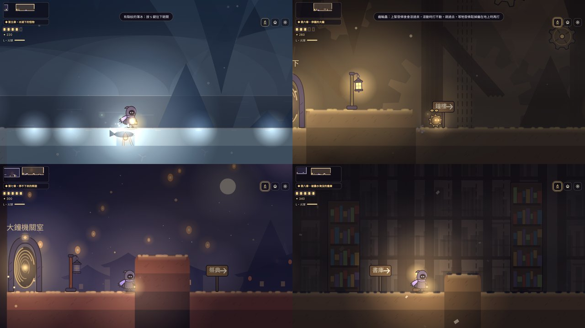

# 地道

### ▶ [立即線上遊玩](https://baichenchen73-art.github.io/lantern-tunnel/)

不用下載、不用登入，電腦和手機的瀏覽器都能玩。

## 遊戲介紹

手繪紙張風格的橫向卷軸冒險遊戲。

你提著一盞燈，從地道的落點醒來。前方一直有個提著同樣燈籠的身影，總是走在你前面，怎麼追都追不上。跟著那道光往深處走，穿過倒映的湖、倒過來的小鎮、燈芯礦坑、結冰的湖面、停擺的鐘樓、紙燈籠祭典的夜空，還有被墨水淹沒的書庫。每到一個地方，就會想起一點被忘掉的事。

## 特色

- **每一章一種新玩法**：衝刺或二段跳、潛水、重力翻轉、燈鏈擺盪、冰面滑行與破冰、機關齒輪、乘著風飛行、划墨水船
- **每一章都有專屬的怪物和 Boss**：怕光的熄燈者、慢半拍模仿你的映照者、要先破解機關的停擺大鐘、跟著鼓點才打得動的祭鼓……
- **燈火技能**：焰火、寒霜、暖光三個派系，打倒 Boss 讓招式進化，也能用光屑強化
- **支線與收集**：每章都有等著你幫忙的角色、記憶碎片，以及可以用地圖傳送的燈籠存檔點
- **電腦與手機都能玩**：電腦用鍵盤（按鍵可以自訂），手機橫拿用觸控按鈕

## 操作（電腦版預設）

| 動作 | 按鍵 |
| --- | --- |
| 移動 | A / D 或 ← → |
| 跳躍（按住跳更高） | 空白鍵 或 ↑ |
| 攻擊 | J 或 滑鼠左鍵 |
| 衝刺 | K 或 滑鼠右鍵 |
| 對話／進入 | E |
| 技能／技能頁面 | L ／ N |
| 地圖 | M |
| 設定 | Esc |

各章學到的新能力（點燈、燈鏈、破冰等），遊戲裡都會提示怎麼按。

## 製作進度

- 第一～七章可以從頭玩到第七章的 Boss，預計全部十章
- 第八章「被墨水淹沒的書庫」製作中
- 遊戲每天都會更新，遊戲內「設定」可以看到目前的版本

存檔存在你自己的瀏覽器裡，換瀏覽器或清除網站資料就會不見。

---

## 給開發者／本機版

整個遊戲就是 `index.html` 一個檔案，沒有外部資源，可以完全離線玩。

### 在自己電腦上玩

| 方式 | 怎麼做 |
|---|---|
| 最簡單 | 雙擊 **`開始遊戲.bat`**：先自動下載最新版，再開啟遊戲（有裝 Node.js 會開在獨立視窗，沒有就用瀏覽器） |
| 用瀏覽器 | 雙擊 **`用瀏覽器開.bat`** |
| 終端機／VS Code | `cd C:\tunnel-game` → `git pull` → `npm start`（第一次先 `npm install`） |

獨立視窗裡：**F11** 全螢幕、**Ctrl+R** 重新整理。本機存檔和網站上的存檔不互通。

### 更新怎麼來

- 每天台灣時間約 12:13、21:13，自動測試會修改遊戲、發佈線上版，並把同一份推到這個儲存庫
- 每次用 `開始遊戲.bat` 開啟時會自動 `git pull` 拿到最新版
- 遊戲內「設定 → 編輯器 → 原始碼」可以看到版本號與每一版的更新紀錄（線上版要在網址後加 `?dev` 才會顯示「捷徑」和「編輯器」）

### 用 VS Code 看程式碼

VS Code →「檔案」→「開啟資料夾」→ 選 `C:\tunnel-game`，先看 **`程式導覽.md`**（給熟悉 C++ 的人）和 **`程式地圖.md`**（每個區塊、房間、函式在第幾行）。改了 `index.html` 按 Ctrl+S，開著的遊戲視窗會自動重新載入。

### 自己修改（選用）

可以在這個資料夾用 Claude Code 修改，規則寫在 `CLAUDE.md`。改完一定要 commit 並 push，下一次自動更新才會以你改過的版本繼續；沒 push 的修改會在下次 `git pull` 時發生衝突。
